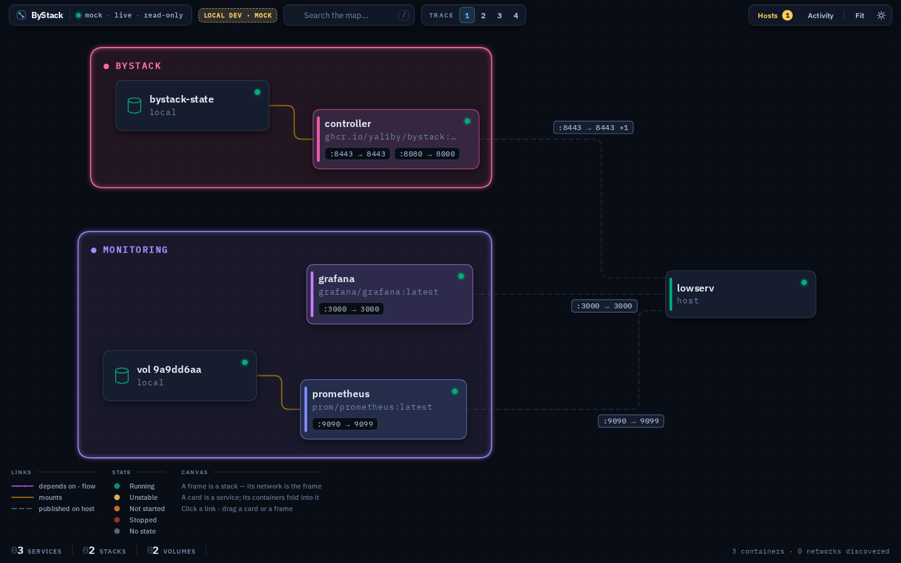
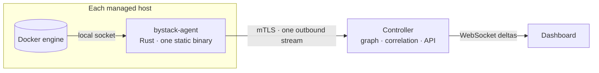

<div align="center">

# ByStack

**A live map of every Docker host you own, and the controls to run them.**

ByStack discovers every container, service and stack on your machines, correlates them into one graph, and lets you act on them from a single dashboard. Each host runs a small agent that dials **out** to the Controller, so nothing on your hosts listens on the network.

[](https://github.com/yaliby/bystack/actions/workflows/ci.yml)


[Quick start](#-quick-start) · [Features](#-features) · [Security](#-security) · [Architecture](#-architecture) · [Documentation](#-documentation)

</div>

<p align="center">
  
  <br><sub>The dashboard, on demo data.</sub>
</p>

> [!NOTE]
> ByStack is **not a monitoring system**. Metrics, logs and alerting stay with the tools that already do them well, such as Prometheus and Grafana. ByStack answers a different question: *what runs where, what depends on what, and can I act on it right now?*

---

## 🧭 How it fits together



Agents **dial out**. A managed host opens no port, publishes no Docker socket and needs no inbound firewall rule, which is what makes it work behind NAT. The Controller decides; the agent observes and obeys.

---

## 🚀 Quick start

Three ways in. They differ only in what you already run. The step-by-step, with the failure modes named, is in [INSTALL.md](INSTALL.md).

**On a Linux server with systemd.** One command. This is the only install that can update itself from the dashboard.

```bash
curl -fsSL https://raw.githubusercontent.com/yaliby/bystack/v0.5.0/scripts/install-controller.sh | sudo sh
```

Then open `http://127.0.0.1:8000`. The first visit asks you to create your administrator account.

> [!TIP]
> On a server you reach over SSH, forward the port from your own machine and leave the server on loopback:
>
> ```bash
> ssh -N -o ExitOnForwardFailure=yes -L 8080:127.0.0.1:8000 you@your-server
> ```
>
> Then open `http://127.0.0.1:8080`.

**In a container.** The Controller manages the engine it is mounted against.

```bash
git clone https://github.com/yaliby/bystack.git && cd bystack
echo "DOCKER_GID=$(stat -c '%g' /var/run/docker.sock)" > .env
docker compose up -d --build
```

**From a checkout.** For development.

```bash
./scripts/build-agent.sh && (cd frontend && npm ci && npm run build)
pip install -e backend && bystack
```

### Adding a host

Open **Hosts → Add host** in the dashboard, and give the machine's address and a root login. The Controller installs the agent over one SSH connection, waits for the machine to dial back, and moves on to the next one, stopping if one fails. A new host contributes nothing until you approve it.

The credential is used for that one connection and is **never stored**: there is no host list, no saved key and nothing to reconnect with ([ADR-0019](docs/adr/0019-agent-deployment-over-ssh.md)).

A machine the Controller cannot reach, such as one behind NAT, gets a command to run on it instead, with the token already in it:

```bash
curl -fsSL https://raw.githubusercontent.com/yaliby/bystack/v0.5.0/scripts/install-agent.sh \
  | sudo sh -s -- --controller wss://controller:8443 --token bst1.…
```

---

## ✨ Features

| | |
|---|---|
| 🗺️ **Live topology** | Containers, services, stacks, volumes and the networks they publish on, correlated into one graph. Changes arrive as deltas over a WebSocket. |
| 🔌 **Outbound-only agents** | One static Rust binary per host, about 2 MiB, dialling the Controller over mutual TLS. Managed hosts open no port and expose no Docker socket. |
| ⚙️ **Lifecycle operations** | Start, stop, restart, pause, unpause and kill a container, a service or a whole stack. A service fans out to its containers, and one failure does not hide the other five. |
| 🧩 **Units and processes** | Watch the systemd units and processes you select, and operate them through the same verbs. |
| 📜 **Logs** | One-shot or live tail of a container's output, with backpressure handled end to end. |
| 🧾 **Audit trail** | Every attempt is recorded, refusals included, with the account that asked. It survives restarts. |
| 🔐 **Sign-in** | Accounts with scrypt hashes, rate limits and lockout, and optional BYheaven single sign-on. |
| 🚚 **Upgrades from the dashboard** | The Controller and the fleet are upgraded from signed releases, one host at a time. A host that cannot reach the Controller again goes back to its previous binary by itself. |
| 🧰 **`bystack-ctl`** | The same operations from a terminal, including account management. |

---

## 🚧 Status

v0.5. The whole path works from the dashboard: install, sign in, operate, upgrade.

| Built | Not built yet | Decided against |
|---|---|---|
| Discovery over outbound agents | Durable graph history | Destructive verbs: `remove`, `prune`, volume deletion ([ADR-0014](docs/adr/0014-no-user-identity.md)) |
| Lifecycle operations on containers, services and stacks | Roles and per-account permissions ([ADR-0020](docs/adr/0020-authentication.md)) | Metrics collection, which Prometheus already does ([ARCHITECTURE §12](ARCHITECTURE.md#12-non-goals)) |
| Watched units and processes | Two-factor sign-in | |
| Live logs | A plugin system | |
| Mutual TLS, join tokens, automatic renewal | | |
| Signed upgrades for agents and the Controller | | |
| Accounts, sign-in and BYheaven single sign-on | | |

---

## 🔐 Security

ByStack is a control plane for machines you own, and it has root-equivalent reach over them. The defaults are conservative on purpose.

| Question | Answer |
|---|---|
| **Who can use the dashboard?** | Signed-in accounts only, and that is on by default. The first visit creates the administrator. |
| **What can an account do?** | Start, stop, restart, pause, unpause and kill. **Nothing deletes.** There is no `remove`, `prune` or volume deletion, and there will not be without an ADR that says what authorizes them. |
| **Are there roles?** | Not yet. Accounts say *who* asked, not *who may*, so every account can do everything the verbs allow. |
| **Where does the Controller listen?** | On loopback by default. Binding to `0.0.0.0` is your decision about the network. |
| **How do agents prove who they are?** | Mutual TLS against an internal CA, single-use join tokens, and your approval for each host. |
| **Can a compromised Controller take over the fleet?** | It can withhold an upgrade, but it cannot force one. Every host verifies a release against a key compiled into its own agent. |
| **Does the Controller keep host credentials?** | No. An SSH credential is used for one install and then dropped. |
| **Is anything recorded?** | Every attempted operation, durably, with the account that asked. |

> [!IMPORTANT]
> A session is a password, and the dashboard speaks plain HTTP. Keep it on loopback and reach it over `ssh -L`, or put a TLS proxy in front of it, before you expose it on a network.

> [!WARNING]
> The optional unit and process grants let the agent stop **any** systemd unit and signal **any** process on that host. The only bound is the host's watch list, which any signed-in account can edit. Install them only on hosts where that is a trade you have chosen on purpose. See [`packaging/polkit/49-bystack-agent.rules`](packaging/polkit/49-bystack-agent.rules) and [ADR-0016](docs/adr/0016-watched-units-and-processes.md).

---

## 🧱 Architecture

The Controller holds the graph, the policy and the API. The agent observes and obeys. Dependencies point strictly inward: the domain kernel imports nothing outward, and every external system is a provider behind a port. [ARCHITECTURE.md](ARCHITECTURE.md) has the reasoning, and [docs/adr/](docs/adr/) has the decisions behind it.

```
backend/src/bystack/    the Controller (Python)
  core/                 domain kernel: identity, graph, ports
  providers/            one per external system, each independent of the others
  runtime/              collector, command service, sign-in, upgrades
  infra/                event bus, audit log, watch lists, accounts, SSH deploy
  api/                  FastAPI routes, the sign-in gate, the dashboard
agent/                  bystack-agent (Rust): one static binary, about 2 MiB
proto/                  the wire contract both sides are written against
frontend/src/           the dashboard (React and TypeScript)
scripts/                installers, builds, release signing
packaging/              systemd units, the polkit rule, the container config
docs/                   decisions, handoff notes, migration, pitfalls
```

---

## 🔧 Operating

### From the terminal

```bash
bystack-ctl status               # is it healthy, and what does it see
bystack-ctl hosts                # the fleet, and which rows need a decision
bystack-ctl token                # mint a join token and print the command for the host
bystack-ctl approve <engine-id>  # let an enrolled host contribute
bystack-ctl deploy 10.0.0.5      # install the agent there over SSH
bystack-ctl upgrade --watch      # roll a signed release out, one host at a time
bystack-ctl user add alice       # accounts: add, passwd, enable, disable, list
```

On the Controller's own machine, `bystack-ctl` reads the control key from the state directory. From anywhere else, set `BYSTACK_CTL_KEY` to that key. On a packaged install, the same commands are `bystack-controller ctl …`.

### The API

Everything is under `/api/v1`, and every route except the health probe and the sign-in routes needs a session, or the control key as `Authorization: Bearer`.

| Method | Route | What it does |
|---|---|---|
| `GET` | `/healthz` | Service and per-provider health. Public, for probes. |
| `GET` | `/graph` | The full snapshot |
| `WS` | `/stream` | A snapshot, then incremental deltas |
| `GET` | `/graph/node/logs?urn=…` | A container's recent output. `…/logs/stream` follows it live. |
| `POST` | `/commands` | Run one operation |
| `GET` | `/commands/actions?urn=…` | What is permitted on a node right now |
| `GET` | `/commands/audit` | Recent operations, including refusals |
| `GET` | `/agents` | The fleet |

Interactive docs are at `/docs`, behind the same sign-in.

### Read-only

`read_only: true` turns the Controller into a viewer. The refusal is enforced in two places: the Controller's command service, and each agent on its own authority. Discovery keeps working either way.

---

## 📝 Configuration

Configuration says only *where to look*. It never describes topology, which is discovered. The full reference is [`backend/bystack.example.yaml`](backend/bystack.example.yaml).

```yaml
agents:
  enabled: true                       # the fleet listener; off until you turn it on
  listen: "0.0.0.0:8443"              # where agents dial in, separate from the dashboard
  server_names: [controller.example]  # the name agents type; the certificate must cover it
  auto_approve: false                 # a valid join token still needs your approval

api:
  host: 127.0.0.1                     # the dashboard; keep it on loopback unless you mean otherwise
  port: 8000

auth:
  required: true                      # `false` restores the old no-login behaviour
  # setup_token: ...                  # 8+ characters, or BYSTACK_SETUP_TOKEN
  # sso_secret: ...                   # 32+ characters, or BYSTACK_SSO_SECRET

read_only: false                      # `true` makes this a viewer
audit:
  durable: true                       # the operations log survives a restart
```

`server_names` is the field a real deployment must set. It is what agents type after `wss://`, and a certificate without that name fails verification correctly and confusingly.

---

## 🧪 Development

```bash
# The Controller, from backend/
python3 -m venv .venv && .venv/bin/pip install -e .
.venv/bin/python -m bystack --config bystack.yaml

# The dashboard, from frontend/: http://localhost:5173, with /api proxied to the Controller
npm ci && npm run dev

# The agent, from agent/. The Controller spawns this binary for its own machine.
cargo build --release
```

```bash
cd backend  && .venv/bin/python -m pytest && .venv/bin/ruff check src tests
cd frontend && npm run typecheck && npm test
cd agent    && cargo test
```

The agent is verified by executable specifications, not by a checklist. Each suite starts a scripted Docker engine on a unix socket and a real Controller, runs the real agent between them, and asserts the behaviour:

| Suite | Checks | Covers |
|---|---|---|
| `python -m bystack.conformance` | 32 | One agent, one engine, one Controller |
| `python -m bystack.conformance.fleet` | 36 | Three agents, three engines, one Controller: partition isolation, partial outages, read-only at both choke points |
| `python -m bystack.conformance.local` | 17 | Zero-config: the Controller spawns an agent for its own machine |

```bash
cd backend && .venv/bin/python -m bystack.conformance ../agent/target/release/bystack-agent
```

No test in the repository needs a Docker daemon or a network. Several of the checks exist because their failures are invisible at runtime: the agent works, the map looks right, and it quietly costs a hundred times more than it should. Those are listed in [docs/PITFALLS.md](docs/PITFALLS.md).

---

## 📚 Documentation

| Document | What it is for |
|---|---|
| [INSTALL.md](INSTALL.md) | Every install path, step by step, with the failure modes named |
| [ARCHITECTURE.md](ARCHITECTURE.md) | The topology, the split of responsibility, and the decisions in one place |
| [docs/adr/](docs/adr/) | Each decision that is hard to reverse, with the reasons it was made |
| [docs/PITFALLS.md](docs/PITFALLS.md) | Traps that cost real debugging time, each pinned by a test |
| [docs/OPEN-WORK.md](docs/OPEN-WORK.md) | The handoff: how to get a green baseline, what is left, and what is already decided |
| [docs/MIGRATION.md](docs/MIGRATION.md) | The move from the agentless design to agents |
| [CHANGELOG.md](CHANGELOG.md) | What changed in each release, and what you have to do about it |

Read [ARCHITECTURE.md](ARCHITECTURE.md) before changing anything. The decisions in it are load-bearing, and several look arbitrary until you know what goes wrong without them.
